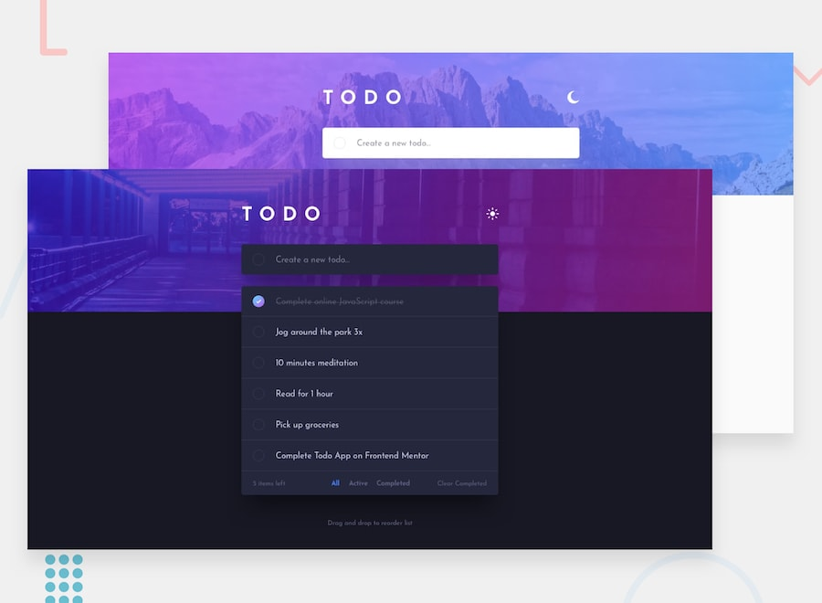

# React practice - todo App

A modern todo app built with **React, TypeScript, and Vite** — a practice project to sharpen component architecture, state management, and theming. Visual design based on the [Frontend Mentor "Todo app" challenge](https://www.frontendmentor.io).



## Features

- **Task management** — add, complete (toggle), and delete todos
- **Filtering** — view All / Active / Completed, plus a "Clear Completed" action
- **Animations** — smooth 0.5s transitions when switching themes, including a crossfading top banner (two stacked layers)
- **Accessibility** — respects `prefers-reduced-motion`; filter buttons expose `aria-pressed` state
- **Responsive layout** — fluid sizing with `clamp()` from 320px up to large screens
- **Dark / light mode** — theme driven by CSS custom properties, toggled via `data-theme` on `<html>`

## Tech stack

| Layer      | Choice                       |
| ---------- | ---------------------------- |
| UI         | React 19                     |
| Language   | TypeScript                   |
| Bundler    | Vite                         |
| Styling    | Plain CSS + design tokens    |
| State      | React Context + reducer      |

## Project structure

```
src/
├── app.tsx            # Root: owns theme state, applies data-theme to <html>
├── index.tsx          # Entry point
├── tasksProvider.tsx  # Global task state (context + reducer)
├── types.ts           # Shared types (Theme, TaskData, ...)
├── components/
│   ├── inputSection.tsx  # Header + "add task" input
│   ├── task-list.tsx     # List, filter footer, clear-completed
│   └── task.tsx          # Single task row
└── style/                # Global, component, and token stylesheets
public/assets/images/     # Banner images + icon SVGs (mobile & desktop variants)
```

## Getting started

```bash
npm install     # install dependencies
npm run dev     # start the dev server
```

Build and preview a production bundle:

```bash
npm run build   # type-check (tsc -b) then bundle (vite build)
npm run preview # serve the built output locally
```

## How the theme works

- Theme state lives in `app.tsx` and is written to `document.documentElement.dataset.theme`.
- All colors are CSS custom properties defined under `:root` (light) and overridden in the `[data-theme="dark"]` block.
- Every component stylesheet references those tokens, so one attribute change repaints the whole app.
- The top banner crossfades between light/dark via two stacked pseudo-elements animating `opacity`.

## Author

Ahmed Habeeb

---

Built as a practice project. Design and assets © Frontend Mentor.